<picture>
  <source media="(prefers-color-scheme: dark)" srcset="./assets/header-dark.svg">
  
</picture>

### Hi, I'm Batuhan

Co-founder & CTO at **[Rise of Digital](https://github.com/riseofdigital)**, a studio in Istanbul that carries brands from their first logo into a 3D world people walk through.

I build the software side of that story:

- **Products and platforms:** multi-tenant SaaS, real-time systems, admin panels that teams actually use
- **3D on the web:** websites people step inside, from Blender model to browser
- **AI integration:** AI in the workflow, self-hosted when the data must stay in-house

**Daily tools:** Laravel · PHP · React · TypeScript · PostgreSQL · Redis · three.js · Blender · Docker

Most of my work lives in private repositories for clients.

[riseof.digital](https://riseof.digital/) · [batuhan@riseof.digital](mailto:batuhan@riseof.digital)

<b>Türkçe</b>

 

**[Rise of Digital](https://github.com/riseofdigital)**'in kurucu ortağı ve CTO'suyum. İstanbul'dan markaları ilk logolarından içinde dolaşılan bir 3D dünyaya taşıyoruz; ben bu hikâyenin yazılım tarafını kuruyorum: çok kiracılı SaaS ürünleri ve gerçek zamanlı sistemler, 3D web siteleri, iş akışına yerleşen ve gerektiğinde kendi sunucunuzda çalışan yapay zekâ.

